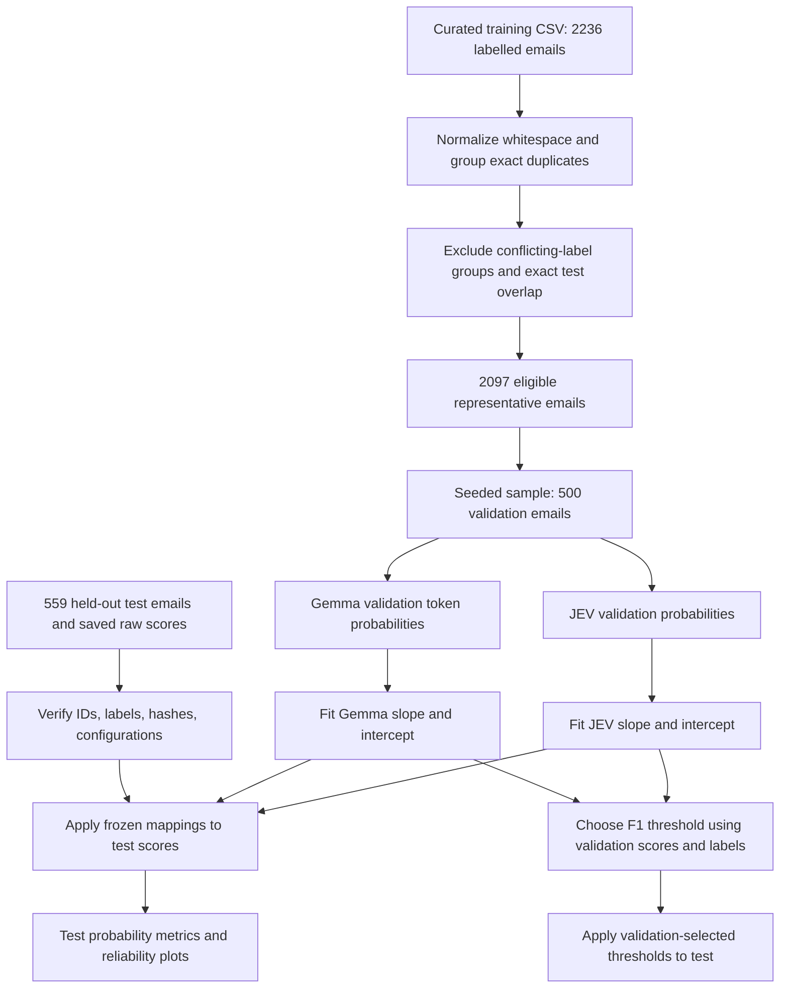
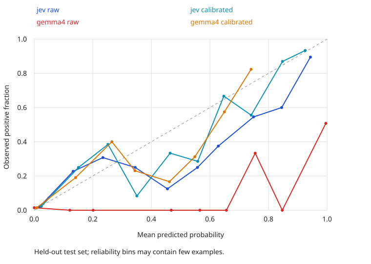

# Understanding calibration: what we did, why we did it, and how every calculation works

This guide explains the **actual calibration implemented in this repository**, from the original model response to the final probability and decision. All reported experiment numbers come from the saved CSV files and [`evaluation.json`](../data/confidence_comparison/evaluation.json). The implementation is [`scripts/evaluate_confidence.py`](../scripts/evaluate_confidence.py); input preparation and score collection are in [`scripts/confidence_comparison.py`](../scripts/confidence_comparison.py).

The central idea is simple: **a model can rank relevant emails well while attaching misleading probabilities to them. Calibration learns how to translate those scores into probabilities that better match the observed labels.** In this experiment that translation was small for JEV and substantial for Gemma.

This is a reconstruction of the completed experiment, not a claim that every design choice was proven optimal. Where a choice was fixed rather than experimentally compared, this guide says so. The documentation update made no new hosted-model requests.

## Reading map

1. [The question a calibrated probability answers](#1-the-question-a-calibrated-probability-answers)
2. [Why calibration was needed](#2-why-calibration-was-needed)
3. [What was and was not calibrated](#3-what-was-and-was-not-calibrated)
4. [The complete data flow](#4-the-complete-data-flow)
5. [How the validation sample was constructed](#5-how-the-validation-sample-was-constructed)
6. [How raw probabilities were obtained](#6-how-raw-probabilities-were-obtained)
7. [The calibration equation](#7-the-calibration-equation)
8. [How the two parameters were fitted](#8-how-the-two-parameters-were-fitted)
9. [The fitted parameters and their interpretation](#9-the-fitted-parameters-and-their-interpretation)
10. [A real email worked through completely](#10-a-real-email-worked-through-completely)
11. [How performance was evaluated](#11-how-performance-was-evaluated)
12. [Results and what they establish](#12-results-and-what-they-establish)
13. [Calibration versus threshold selection](#13-calibration-versus-threshold-selection)
14. [Probability versus confidence and uncertainty](#14-probability-versus-confidence-and-uncertainty)
15. [Files, integrity checks, and reproduction](#15-files-integrity-checks-and-reproduction)
16. [Using the calibrator on a new email](#16-using-the-calibrator-on-a-new-email)
17. [Limitations and when to recalibrate](#17-limitations-and-when-to-recalibrate)
18. [Questions and answers](#18-questions-and-answers)
19. [Glossary and code map](#19-glossary-and-code-map)

## 1. The question a calibrated probability answers

The label being predicted is **relevance to substantive Enron accounting irregularities**. Label `1` includes substantive discussion of misleading reporting, improper mark-to-market valuation, hidden losses, and misuse of special-purpose entities. The broad benchmark includes relevant news and allegations. Label `0` means the email does not meet that relevance definition.

For an email with calibrated positive probability `q = 0.70`, the intended interpretation is:

> Among comparable emails receiving probabilities around 0.70, approximately 70% should have curated label 1.

It is a statement about observed frequencies across comparable examples. It is not a guarantee for this individual email, a probability that a crime occurred, or a probability that every human reviewer would agree with the label.

Formally, ideal calibration means `P(Y=1 | Q=q) = q`. Since we have only 559 test emails and most scores are distinct, we cannot directly estimate that frequency at each exact number. We inspect groups of nearby probabilities and use aggregate scoring metrics instead.

Three questions must be kept separate:

| Question | Example | What measures it? |
| --- | --- | --- |
| Does the score put relevant emails above irrelevant ones? | Relevant email scores 0.99; irrelevant email scores 0.90 | Ranking metrics such as ROC AUC and average precision |
| Does the numerical probability match observed frequencies? | Of emails scored around 0.90, roughly 90% are positive | Reliability plots, Brier score, log loss, ECE |
| Which emails should enter a review queue? | Review everything above 0.30 | A threshold and its precision, recall, and review workload |

A workflow can perform well on one question and poorly on another.

## 2. Why calibration was needed

The strongest evidence was Gemma's extreme raw probabilities. On the **500-email validation sample**, its raw scores grouped as follows:

| Raw Gemma score interval | Emails | Positive labels | Observed positive rate |
| --- | ---: | ---: | ---: |
| `[0, 0.0001)` | 359 | 2 | 0.56% |
| `[0.0001, 0.01)` | 7 | 0 | 0.00% |
| `[0.01, 0.5)` | 11 | 1 | 9.09% |
| `[0.5, 0.99)` | 23 | 6 | 26.09% |
| `[0.99, 0.9999)` | 15 | 5 | 33.33% |
| `[0.9999, 1]` | 85 | 53 | 62.35% |

The last row is the clearest example: all 85 scores were at least **99.99%**, yet only 53 emails, about **62%**, were actually positive. The group below 0.0001 also contained two positives. The raw outputs were too extreme in both directions.

These are descriptive groups, not the bins or targets used to fit the calibrator. The fit uses all 500 individual score/label pairs directly.

JEV's raw probabilities were already closer to the observed labels, but we applied the same calibration family separately to JEV so both workflows could be evaluated consistently. Their parameters were not shared.

The purpose was to make probabilities more useful for interpreting risk, comparing workflows, and eventually choosing operating thresholds. It was not to maximize test recall at a fixed numerical cutoff. Better probability estimates can reduce recall at 0.5; that happens here.

## 3. What was and was not calibrated

Only two score workflows were calibrated:

| Workflow | Raw input to calibration | Calibrated here? |
| --- | --- | --- |
| JEV structured decision | Native positive probability returned by the decisions API | Yes |
| Gemma one-token score | Normalized probabilities of exact `0` and `1` tokens | Yes |
| Gemma JSON include/exclude news | Discrete label, source type, and short reason | No |
| Gemma JSON reasoning disabled | Discrete label with an explanation | No |
| Gemma recovered reasoning | Discrete labels from the mixed historical/recovery workflow | No |
| Gemini Decision 1 | Native positive probability | No; the saved experiment reports raw scores only |

A JSON label of `1` is not itself a probability of 1.0. Similarly, the length or persuasiveness of a textual reason was not converted into a confidence score. The Gemma calibrator belongs to the **specific one-token scoring prompt and settings**, not to every use of the Gemma model.

The hosted model weights were unchanged. The only fitted quantities were two numbers per model: a slope and an intercept.

## 4. The complete data flow



The distinction between validation and test is essential:

- **Validation labels fit the mapping.** They are also used to choose the optional F1 threshold.
- **Test labels measure the resulting performance.** They are not passed to the fitting or threshold-selection functions.
- **Training labels do not train the hosted language model.** The source file happens to be named “train”; this experiment uses a subset of it to train the small calibration layer.

The test set had been inspected during earlier exploratory work. Therefore “held out from this numerical fit” is accurate; “never seen during the project” would not be accurate.

## 5. How the validation sample was constructed

The exact procedure lives in `inputs()` in [`confidence_comparison.py`](../scripts/confidence_comparison.py).

### 5.1 Start with the original curated files

| Population | Emails | Positives | Negatives | Positive fraction |
| --- | ---: | ---: | ---: | ---: |
| Original training file | 2,236 | 318 | 1,918 | 14.22% |
| Calibration/validation sample | 500 | 67 | 433 | 13.40% |
| Test file | 559 | 73 | 486 | 13.06% |

The validation sample is drawn from the training file; it is not an additional independent corpus. The test file is left intact for replay.

### 5.2 Normalize whitespace for duplicate detection

The canonicalization function replaces runs of whitespace with one space and strips leading/trailing whitespace:

```python
re.sub(r'\s+', ' ', email).strip()
```

For example, `"abc\r\n  def"` and `"abc\n def"` share the canonical key `"abc def"`.

This normalized text is used for **duplicate comparisons**, not as a replacement for the original email submitted to the model. Input hashes still refer to the actual email text used by the historical requests.

### 5.3 Group duplicates and remove ambiguity

Training emails with identical canonical text are grouped. A group is eligible only if all its labels agree. Conflicting-label groups are excluded rather than resolved by majority vote. For an eligible group, the first source row is the representative.

Any group whose canonical text also appears in test is excluded from the calibration pool. This prevents the same whitespace-normalized email from being used both to fit and evaluate the mapping.

The combined eligibility procedure leaves **2,097** representative training emails. The difference between 2,236 and 2,097 must not be attributed entirely to one cause: deduplication, conflicting labels, and test overlap are combined in the procedure.

### 5.4 Sample deterministically

The code uses:

```python
random.Random(20261001).sample(eligible, 500)
```

The selected records are sorted by source row for storage. This is a random sample, not a deliberately class-balanced or stratified sample. The 67-positive count is an outcome of that selection. There is no oversampling or class weighting in the calibration fit.

The sample size 500 and seed are fixed experiment settings. The repository does not contain a sample-size power calculation establishing 500 as optimal. Only 67 positive validation cases support the fit, so parameter uncertainty remains meaningful.

### 5.5 Freeze a manifest

[`confidence_validation_manifest.json`](../data/confidence_validation_manifest.json) records the seed, validation row indices, email hashes, class count, pool size, and duplicate rule. If reconstructing the sample produces a different manifest, the loader stops instead of quietly replacing the experiment.

`source_row` is a zero-based index in the corresponding CSV. Validation row 2 would refer to the training file; test row 2 refers to the test file. Always keep the source split with the row ID.

### 5.6 Remaining dependence

Whitespace-normalized exact deduplication does not identify near-duplicate forwards, related articles, revised messages, or members of the same thread. Similar material may remain across calibration and test. No thread-level, author-level, or time-based split was implemented here.

## 6. How raw probabilities were obtained

### 6.1 JEV: reuse its native probability

JEV uses the structured question in `QUESTION` in [`jev_openrouter.py`](../scripts/jev_openrouter.py). The question asks whether an email substantively discusses the specified Enron accounting concerns and explicitly includes relevant news.

The requested model is `typesafe/jev-1.13`; saved responses report `typesafe/jev-1.13-20260917`. The API's numeric `answers.relevant.noul` value is used directly as raw positive probability `p`. The repository checks that it is finite and between 0 and 1.

Existing test predictions were reused; 500 validation scores were collected separately. The code does not expose or reconstruct the vendor's internal computation of that probability. Its empirical quality is what calibration evaluates.

### 6.2 Gemma: obtain a probability from label-token log probabilities

The model is `google/gemma-4-26b-a4b-it`. Its scoring prompt ends with an instruction to output exactly one digit, `0` or `1`, with no explanation. This is separate from the older JSON classification prompt.

The saved scoring configuration is:

```python
{
    'reasoning': {'enabled': False},
    'temperature': 1,
    'top_p': 1,
    'max_tokens': 1,
    'logprobs': True,
    'top_logprobs': 20,
    'provider': {'only': ['darkbloom'], 'require_parameters': True}
}
```

Temperature 1 and top-p 1 request no temperature scaling or nucleus truncation from those particular controls. That does not establish that the hosted distribution is identical to some inaccessible base-model distribution; the measurement remains specific to this provider and API behavior. Parameter requirements are intended to reject unsupported configurations rather than silently dropping them.

Let `l0` be the returned log probability of exact token `"0"`, and `l1` that of exact token `"1"`. Since a log probability is the natural logarithm of a probability, exponentiation converts back:

```text
P0 = exp(l0)
P1 = exp(l1)
raw positive score p = P1 / (P0 + P1)
```

The denominator conditions on the two accepted label tokens. If the model assigned 0.2 to `0`, 0.6 to `1`, and 0.2 to all other tokens, the score would be `0.6 / 0.8 = 0.75`, not 0.6. The accompanying `label_probability_mass` would be 0.8. Thus normalization and calibration solve different problems: normalization restricts to label alternatives; calibration learns agreement with human labels.

For stable arithmetic the implementation computes:

```text
m = max(l0, l1)
p = exp(l1-m) / (exp(l0-m) + exp(l1-m))
```

Equivalently, `p = sigmoid(l1-l0)`. Subtracting the same constant from both log probabilities leaves the ratio unchanged while avoiding unnecessary numerical underflow.

### 6.3 Why the sampled token does not determine the decision

At temperature 1, a sampled `0` or `1` can vary even when the underlying returned scores are unchanged. This experiment defines the raw decision as `int(p >= 0.5)`, using the probability rather than that random sampled token. `sampled_token` is retained as telemetry.

### 6.4 Missing alternatives and reasoning checks

The parser requires one output-token position and both exact digit alternatives. It also considers the sampled token's own log probability if needed. If either label is unavailable, it records `missing_label_probability` with no valid probability; it does not fill the missing label with zero probability. Evaluation rejects incomplete coverage.

Nonfinite or censored log probabilities are rejected. Nonzero reported reasoning tokens or returned reasoning content cause an error. Missing reasoning-token telemetry is stored as unknown, not automatically interpreted as zero.

For these saved 500 validation plus 559 test Gemma calls, both label alternatives were available and zero reasoning tokens were reported. That is evidence about this completed run, not a guarantee for future providers.

## 7. The calibration equation

The selected method is a **regularized sigmoid mapping of raw log odds**, often described as a Platt-style calibration layer:

```text
p_c = clip(p, epsilon, 1-epsilon)        epsilon = 1e-12
x   = log(p_c / (1-p_c))                raw log odds
z   = a*x + b                          fitted linear adjustment
q   = 1 / (1 + exp(-z))                 calibrated positive probability
```

Some descriptions of Platt scaling apply a sigmoid directly to a model's decision score. Here the input to the linear adjustment is explicitly the **logit of the raw probability**. That detail matters for reproducing this experiment.

### 7.1 Why convert to log odds?

A probability lives between 0 and 1. Odds `p/(1-p)` compare positive probability with negative probability; log odds convert that ratio to a scale that can be adjusted linearly.

| Probability | Odds | Log odds, approximately |
| --- | ---: | ---: |
| 0.01 | 1:99 | -4.595 |
| 0.10 | 1:9 | -2.197 |
| 0.50 | 1:1 | 0 |
| 0.90 | 9:1 | 2.197 |
| 0.99 | 99:1 | 4.595 |

A sigmoid converts the adjusted value back to a valid probability. Without adjustments, `a=1, b=0`, the sigmoid undoes the logit and returns the original clipped probability.

### 7.2 What the slope does

The slope rescales differences on the log-odds axis. A slope between 0 and 1 compresses those differences; a slope above 1 expands them. The intercept must be considered at the same time, so a slope alone is not a complete diagnosis of every region's overconfidence.

A useful exact interpretation is:

```text
calibrated odds = exp(b) * (raw odds)^a
```

This shows why a small slope can strongly compress extreme raw odds.

### 7.3 What the intercept does

The intercept shifts all adjusted log odds. Since `logit(0.5)=0`, `sigmoid(b)` is the calibrated probability assigned to raw 0.5. A negative intercept moves that midpoint toward label 0.

The intercept reflects the observed relationship between scores and labels in the calibration population, including its class balance. It is not simply the logarithm of the dataset's positive fraction, because the slope and score distribution also matter.

### 7.4 Why clip probabilities?

`logit(0)` and `logit(1)` are infinite. Clipping to `[1e-12, 1-1e-12]` makes the fit finite and stable. The transformation cannot distinguish raw scores beyond those clipped extremes; it can introduce ties there.

The stable sigmoid in code is `exp(-logaddexp(0, -z))`, mathematically equivalent to `1/(1+exp(-z))` while avoiding overflow for large negative values. The logit uses `log(p)-log1p(-p)` for stable evaluation.

### 7.5 Why this method?

It provides a smooth, monotonic mapping with just two interpretable parameters. That is a reasonable low-complexity choice with 500 validation examples and 67 positives. The regularizer helps stabilize slope estimation. A more flexible mapping could fit local irregularities but could also fit noise.

The code did **not** run a systematic comparison against isotonic regression, beta calibration, temperature scaling, or bin-based calibration. Those are potential future comparisons; this experiment does not prove the chosen method is best. The positive-slope check also intentionally rejects reversal rather than trying to repair a score that ranks the classes backward.

## 8. How the two parameters were fitted

The function `fit_calibrator(probabilities, labels)` uses all 500 validation pairs for one model. The test arrays never enter it.

### 8.1 The objective

For validation email `i`, let `y_i` be its label and `z_i = a*x_i+b`. The objective is:

```text
L(a,b) = sum_i [log(1+exp(z_i)) - y_i*z_i] + 0.5*a^2
```

The bracketed expression is binary cross-entropy, also called negative log likelihood. The implementation uses `logaddexp(0,z_i)` to calculate it stably.

For a positive label, assigning tiny probability is heavily penalized. For a negative label, assigning probability near 1 is heavily penalized. Minimizing this loss encourages probabilities that match observed outcomes in aggregate; it is not direct optimization of accuracy, recall, F1, ECE, or Brier score.

### 8.2 The regularizer

The term `0.5*a^2` is a fixed L2 penalty of strength 1 on the slope. There is no intercept penalty. It pulls the slope toward zero, not toward one. Its rationale is numerical/statistical restraint on extreme slope fits; it was fixed, not tuned on test labels.

Importantly, the data loss is a **sum**, not a mean. An implementation using mean loss plus the same numerical penalty would impose a much stronger relative penalty and would not reproduce these parameters. In average-loss units, this objective is equivalent to mean cross-entropy plus `a^2/(2*500)` for this sample.

### 8.3 Design matrix and derivatives

Define `X_i = [x_i, 1]`, `beta = [a,b]`, and `q = sigmoid(X @ beta)`. The implementation uses:

```text
gradient = X.T @ (q-y) + [a, 0]
Hessian  = X.T @ diag(q*(1-q)) @ X + diag([1,0]) + 1e-10*I
```

The tiny diagonal term stabilizes the numerical linear solve. It is not a separately tuned modeling penalty.

The gradient indicates which parameter changes reduce loss; the Hessian describes local curvature. Solving `Hessian * step = gradient` gives a Newton step. No generic machine-learning training service is involved; NumPy solves a 2-by-2 system.

### 8.4 Iteration and stopping

The actual algorithm is:

1. Start with `beta = [1,0]`, the identity probability mapping before clipping.
2. Calculate gradient and Hessian.
3. Solve for a Newton step.
4. Try the full update `beta - step`.
5. If its objective is worse, repeatedly halve the step scale; the loop stops halving below `1e-8`.
6. Apply the scaled update.
7. Stop if the largest absolute scaled parameter change is below `1e-8`, or after 100 iterations.
8. Reject a resulting slope less than or equal to zero.

Both classes must appear in the fitting labels. The function does not report a confidence interval, a formal convergence flag, or parameter standard errors. The iteration limit and change tolerance are computational safeguards; they do not quantify how precisely the true population mapping is known.

### 8.5 What labels influence

Labels affect the choice of `a` and `b` through this loss. The fitted mapping never reads email content, sender, date, or a model explanation; its only per-email input is the original score. It cannot distinguish two different emails with the same raw score.

## 9. The fitted parameters and their interpretation

The exact saved values are:

| Model | Slope `a` | Intercept `b` |
| --- | ---: | ---: |
| JEV | 0.833138549129005 | -0.39114651659180755 |
| Gemma | 0.20275758029074742 | -2.2347107907697175 |

JEV's slope is relatively close to 1, with a modest negative intercept. Gemma's slope compresses log odds much more strongly and its intercept lowers the midpoint substantially.

Here is the actual mapping, rounded:

| Raw positive probability | JEV calibrated | Gemma calibrated |
| ---: | ---: | ---: |
| 0.01 | 0.01449 | 0.04045 |
| 0.10 | 0.09782 | 0.06415 |
| 0.50 | 0.40344 | 0.09668 |
| 0.90 | 0.80837 | 0.14317 |
| 0.95 | 0.88715 | 0.16278 |
| 0.99 | 0.96885 | 0.21366 |
| 0.9999 | 0.99931 | 0.40920 |

The mapping can raise low probabilities while lowering high ones. Gemma raw 0.01 becomes about 0.04, while raw 0.99 becomes about 0.21. This is consistent with correcting excessive certainty in both directions.

At the clipping endpoints, Gemma maps raw 0 to about 0.000395 and raw 1 to about 0.96668. Those are mathematical consequences of the fitted mapping and clipping rule, not empirically validated confidence bounds. The maximum actual saved calibrated test score is lower than that mathematical upper endpoint.

A score of 0.99 before calibration and 0.214 afterward is not a contradiction: the first is the model-derived score, the second is an estimate adjusted using how such scores behaved against curated labels.

## 10. A real email worked through completely

Use **test source row 2**, whose curated label is `0`. No email content is needed to reproduce the arithmetic.

The saved Gemma row in [`gemma4_probability_test.csv`](../data/gemma4_probability_test.csv) contains:

```text
logprob_0 = -2.9997406005859375
logprob_1 = -0.0511474609375
label     = 0
```

### 10.1 Convert token log probabilities to the raw score

```text
l1-l0 = 2.9485931396484375
p = sigmoid(2.9485931396484375)
  = 0.9501969541590248
```

At raw cutoff 0.5, this is a positive prediction. Since the curated label is 0, it is a false positive at that operating point.

### 10.2 Calculate raw log odds

```text
x = log(p/(1-p))
  = 2.9485931396484375, approximately
```

This matches the log-probability difference because the score was normalized over two tokens.

### 10.3 Apply the fitted calibration layer

```text
z = 0.20275758029074742*x - 2.2347107907697175
  ≈ -1.6369
q = sigmoid(z)
  ≈ 0.1629
```

The raw 95% score becomes about **16.3% positive probability**. At calibrated cutoff 0.5, this email is predicted negative.

### 10.4 Check a single-email loss

For a negative label, Brier loss is `p^2`. Before calibration it is about `0.9502^2 = 0.9029`; afterward it is about `0.1629^2 = 0.0265`. Negative-label log loss is `-log(1-p)`: roughly 3.00 before and 0.18 afterward.

This is one example where calibration helps. A positive email whose score is lowered could instead incur greater loss. The aggregate held-out results, not this selected illustration, establish the observed overall improvement.

### 10.5 Reproduce directly

From the repository root after installing NumPy:

```python
from scripts.confidence_comparison import read_csv
from scripts.evaluate_confidence import calibrate
import json

row = next(r for r in read_csv('data/gemma4_probability_test.csv')
           if int(r['source_row']) == 2)
report = json.load(open('data/confidence_comparison/evaluation.json'))
params = report['models']['gemma4']['calibrator']
p = float(row['probability'])
q = float(calibrate([p], params)[0])
print({'label': int(row['label']), 'raw': p, 'calibrated': q,
       'raw_prediction': int(p >= .5),
       'calibrated_prediction': int(q >= .5)})
```

## 11. How performance was evaluated

After fitting each mapping, `evaluate()` applies it to that model's 559 verified test scores. It computes raw and calibrated metrics on exactly the same labels.

### 11.1 Brier score

```text
Brier = mean((probability - label)^2)
```

Lower is better. It rewards accurate probabilities and penalizes confident mistakes. A negative label scored 0.9 contributes 0.81; the same label scored 0.1 contributes 0.01.

Brier score reflects more than calibration alone: discrimination and population uncertainty also matter. An improvement is useful evidence of probability quality, not a proof of perfect calibration.

### 11.2 Log loss

```text
log_loss = -mean(y*log(p) + (1-y)*log(1-p))
```

Lower is better. Log loss heavily punishes assigning nearly zero probability to the true class. Gemma's confident wrong scores therefore caused a particularly large raw log loss.

For evaluation only, probabilities are clipped to `[1e-15, 1-1e-15]` before taking logs. This differs from the `1e-12` clipping used before the calibration logit. The two constants serve different numerical calculations.

### 11.3 Reliability diagram

The code groups probabilities into ten equal-width intervals: `[0,0.1)`, `[0.1,0.2)`, and so on, with 1 included in the last interval. Empty bins are omitted.

For each bin it records count, mean predicted probability, and actual positive fraction. The chart plots mean prediction horizontally and observed positive fraction vertically. Perfect group-level calibration would fall on the diagonal. A point below the diagonal indicates overprediction of the positive rate in that group.



Raw and calibrated bins contain different emails because calibration moves the scores. Comparing bin 0.5–0.6 before and after does not compare an identical population. Small bins are noisy, and connected lines are a visual aid rather than evidence of a smooth empirical curve.

### 11.4 Ten-bin expected calibration error

```text
ECE = sum_bins (n_bin / N) * abs(mean_probability - positive_fraction)
```

Lower is better. For raw Gemma, the 0.9–1.0 test bin contains 130 emails, with mean score about 0.99576 and observed positive fraction 66/130 = 0.50769. That bin alone contributes about:

```text
(130/559) * abs(0.99576 - 0.50769) ≈ 0.1135
```

to total raw ECE 0.13938.

ECE depends on bin choices and sample size. A small total can hide a badly calibrated small subgroup; it should be read with the bin counts and other metrics. The ten bins are an evaluation choice, not ten learned calibration parameters.

### 11.5 Ranking metrics

ROC AUC measures how often a randomly chosen positive receives a higher score than a randomly chosen negative; ties receive half credit. Average precision accumulates precision as recall rises while thresholds descend through unique scores, grouping ties.

A strictly increasing mapping preserves score order, so ranking metrics are normally unchanged. Clipping or floating-point ties can alter that statement at extremes. In these saved results, both AUC and average precision are unchanged by calibration. Calibration did not add new information about which emails should rank first.

### 11.6 Classification metrics

At a selected cutoff, the decision is `probability >= cutoff`. The evaluator reports TP, FP, FN, TN, precision `TP/(TP+FP)`, recall `TP/(TP+FN)`, and F1 `2*TP/(2*TP+FP+FN)`.

These describe a decision rule. They cannot by themselves establish whether a probability is calibrated.

## 12. Results and what they establish

All rows below are measured on the same 559 test emails, with a numerical cutoff of 0.5 applied to the indicated probability scale.

| Workflow | Brier ↓ | Log loss ↓ | ECE ↓ | ROC AUC | Average precision |
| --- | ---: | ---: | ---: | ---: | ---: |
| JEV raw | 0.06065 | 0.20234 | 0.03365 | 0.94206 | 0.77175 |
| JEV calibrated | 0.05702 | 0.19431 | 0.02485 | 0.94206 | 0.77175 |
| Gemma raw | 0.13483 | 1.35332 | 0.13938 | 0.94213 | 0.73468 |
| Gemma calibrated | 0.06243 | 0.20092 | 0.03356 | 0.94213 | 0.73468 |

| Workflow | TP | FP | FN | TN | Precision | Recall | Alerts |
| --- | ---: | ---: | ---: | ---: | ---: | ---: | ---: |
| JEV raw | 51 | 24 | 22 | 462 | 68.00% | 69.86% | 75 |
| JEV calibrated | 47 | 16 | 26 | 470 | 74.60% | 64.38% | 63 |
| Gemma raw | 67 | 74 | 6 | 412 | 47.52% | 91.78% | 141 |
| Gemma calibrated | 56 | 34 | 17 | 452 | 62.22% | 76.71% | 90 |

The probability-quality improvements are much larger for Gemma. JEV improves modestly. Both produce fewer alerts and lower recall at calibrated 0.5 because the transformation effectively raises the raw-score requirement.

Calibration remains imperfect. For example, the calibrated Gemma 0.5–0.6 bin contains 16 test emails with mean probability about 0.549, but only 5/16 = 0.3125 are positive. A lower overall ECE does not mean every subgroup is correct.

There are no bootstrap intervals or formal paired significance tests in this calibration evaluation. These are observed point estimates on a small, previously inspected benchmark; they do not establish universal superiority or guaranteed production improvement.

## 13. Calibration versus threshold selection

**Calibration determines what a probability means. A threshold determines what action to take.** The objective optimized for calibration is log loss, not an operational recall target.

### 13.1 Why calibrated 0.5 is a different decision rule

Solving the calibration equation for the raw score that yields a chosen calibrated threshold `t` gives:

```text
raw_threshold = sigmoid((logit(t) - b) / a)
```

At calibrated `t=0.5`, this becomes `sigmoid(-b/a)`:

| Model | Raw cutoff equivalent to calibrated 0.5 |
| --- | ---: |
| JEV | 0.61526199 |
| Gemma | 0.9999836553 |

Thus Gemma's lower recall after calibration at 0.5 is unsurprising: it now takes an extraordinarily high raw score to enter the queue.

Because the mapping is increasing, an appropriately transformed threshold can recover the same raw-score ordering and queue. A claim that calibration itself “made the model miss more emails” is incomplete without specifying the cutoff. A fixed review budget based only on ranking would ordinarily select the same top emails before and after calibration, apart from ties.

### 13.2 The optional validation-selected F1 threshold

The code also evaluates every unique calibrated **validation** score as a candidate cutoff. It selects the highest F1, breaking ties by higher precision and then higher threshold. It applies that selected cutoff unchanged to test.

| Model | Calibrated validation-selected cutoff | Equivalent raw cutoff | Test TP | Test FP | Test FN |
| --- | ---: | ---: | ---: | ---: | ---: |
| JEV | 0.34842544 | 0.43 | 52 | 30 | 21 |
| Gemma | 0.47849680 | 0.99997501 | 57 | 39 | 16 |

Despite its JSON key name, `validation_selected_threshold` contains **test confusion counts at a validation-selected threshold**. It does not report validation performance in those count fields.

This procedure uses the same 500 validation emails both to fit calibration and select the cutoff. Test remains outside both calculations, but validation performance itself would be optimistic for selection. No nested cross-validation or additional threshold-selection holdout was used.

F1 is a convenient reference objective, not a business cost model. For a review workflow, choose the threshold from separate operational validation data using required recall, acceptable review volume, and the relative consequences of false alerts and missed cases. The supplied report additionally explores validation-recall targets; those are separate from this F1 selector.

### 13.3 Why 0.5 is not automatically the right action threshold

Even a perfectly calibrated relevance probability need not imply a 0.5 review threshold. If the consequence of missing a relevant email is much larger than the cost of reviewing an irrelevant one, a lower threshold can be appropriate. This experiment did not estimate those costs or derive a production-optimal cutoff.

## 14. Probability versus confidence and uncertainty

The output columns use several related but different quantities:

| Field | Meaning |
| --- | --- |
| `raw_probability` | Original score for label 1 |
| `calibrated_probability` / calibrated `probability` | Adjusted estimate for label 1 |
| `prediction` | Whether calibrated positive probability is at least 0.5 in the standard output |
| `predicted_class_confidence` | `max(q, 1-q)` for that standard 0.5 decision |

For `q=0.163`, predicted label is 0 and predicted-class confidence is about 0.837. For `q=0.80`, predicted label is 1 and confidence is 0.80.

That confidence field assumes the standard 0.5 decision rule. If a custom threshold of 0.10 predicts label 1 for `q=0.163`, its probability for the selected class is 0.163, not `max(q,1-q)`. Do not reuse the field's name uncritically after changing the decision rule.

No per-email confidence interval is calculated. A calibrated point probability and uncertainty about the fitted parameters are separate concepts. The procedure does not quantify how the estimate would vary across a new calibration sample, nor uncertainty due to ambiguous labels or distribution shift.

## 15. Files, integrity checks, and reproduction

### 15.1 Exact inputs and outputs

| File | Role |
| --- | --- |
| [`enron_labeled_curated_train.csv`](../data/enron_labeled_curated_train.csv) | Original training pool containing validation source rows |
| [`enron_labeled_curated_test.csv`](../data/enron_labeled_curated_test.csv) | Held-out test emails and labels |
| [`confidence_validation_manifest.json`](../data/confidence_validation_manifest.json) | Frozen sample membership and input hashes |
| [`jev_probability_validation.csv`](../data/jev_probability_validation.csv) | JEV scores on 500 validation emails |
| [`gemma4_probability_validation.csv`](../data/gemma4_probability_validation.csv) | Gemma scores and label-token telemetry on validation |
| [`jev_test_predictions.csv`](../data/jev_test_predictions.csv) | Reused historical JEV test probabilities |
| [`gemma4_probability_test.csv`](../data/gemma4_probability_test.csv) | Gemma scores and token telemetry on test |
| [`confidence_comparison/evaluation.json`](../data/confidence_comparison/evaluation.json) | Exact fitted parameters, metrics, costs, configurations, and reliability bins |
| [`jev_test_probabilities.csv`](../data/confidence_comparison/jev_test_probabilities.csv) | Per-email raw/calibrated JEV probabilities and standard decisions |
| [`gemma4_test_probabilities.csv`](../data/confidence_comparison/gemma4_test_probabilities.csv) | Per-email raw/calibrated Gemma probabilities and standard decisions |
| [`calibration.svg`](../data/confidence_comparison/calibration.svg) | Raw/calibrated test reliability diagram |
| [`precision_recall.svg`](../data/confidence_comparison/precision_recall.svg) | Raw score precision–recall curves |

The saved precision–recall SVG displays raw scores. It does not need a separate calibrated curve to establish the preserved ranking; the numerical report contains both raw and calibrated ranking metrics.

### 15.2 Checks before fitting and evaluation

The supplied workflow verifies:

1. Historical JEV test IDs match the source set with no duplicate saved IDs.
2. Historical email SHA-256 values and curated labels match the source inputs.
3. Where needed, LF/CRLF variants are considered explicitly to recover the historical text, rather than ignoring a hash mismatch.
4. JEV's historical configuration hash and 0.5 decisions match the expected setup.
5. The reconstructed validation manifest is identical to the saved manifest.
6. Validation and test prediction files have exactly the expected IDs, labels, and input hashes.
7. Validation configurations match current scoring settings; Gemma test configurations also match. Historical JEV test uses its original configuration hash convention checked earlier in `inputs()`.
8. Required score statuses indicate complete probability coverage.
9. The score evaluator rejects nonfinite or out-of-range probability arrays.

Input SHA-256 proves consistency with a particular text, not label correctness. Configuration hashes record settings, not a guarantee that a remote provider will always serve identical weights or behavior. Near-duplicate leakage is not solved by matching hashes.

### 15.3 Offline reproduction

From the repository root:

```bash
python3 -m venv .venv
source .venv/bin/activate
python -m pip install -r requirements.txt
python -m scripts.evaluate_confidence
```

On Windows, activate with `.venv\Scripts\Activate.ps1` in PowerShell instead. For just the offline calibration script, NumPy is the only external dependency; the broader requirements file supports the notebooks too.

The evaluation command refits from the saved validation predictions, applies to saved test predictions, and rewrites the evaluation JSON, per-email output CSVs, and SVGs. It needs **no API key** and makes no API calls. Minor floating-point differences between numerical environments can affect the last decimal places.

For visual exploration open [`jev_gemma4_confidence.ipynb`](../EDA/jev_gemma4_confidence.ipynb). For inherited focused tests, run:

```bash
python -m unittest discover -s tests -p 'test_confidence_comparison.py'
```

Those tests cover normalized token probabilities, missing alternatives, tied-score metrics, a synthetic overconfidence example, and whitespace canonicalization. They do not prove that production probabilities are calibrated.

### 15.4 Recollecting raw probabilities is a different operation

```bash
python -m scripts.confidence_comparison --collect
```

This resumes missing API scoring and requires `OPENROUTER_API_KEY` for new requests. It can incur charges. Matching completed rows are reused, and incompatible saved settings are rejected. Model/provider availability and behavior may have changed since the historical experiment.

For a deliberately changed experiment, use separately versioned inputs, configurations, manifests, and outputs. Do not mix scores from different prompts or providers into the same calibration file just to satisfy the resume mechanism.

### 15.5 Cost of fitting versus collecting

The calibration computation itself is local and incurs no hosted-model charge. Recorded API costs for collecting scores were:

| Model | Validation scoring | Test scoring |
| --- | ---: | ---: |
| JEV | $0.01615782 | $0.018534642 |
| Gemma | $0.0114716745 | $0.01357957458 |

The validation scoring total across models was about $0.02763. Replaying from saved files adds no API cost. Recorded totals do not include human labelling, review, integration, compute overhead, or unrecorded failed requests. They are historical usage records, not current prices.

## 16. Using the calibrator on a new email

The supported helper is:

```python
from scripts.confidence_comparison import predict_with_confidence

result = predict_with_confidence(email_text, model='gemma4')
# Or model='jev'. Requires a local API key and makes a billable request.
```

It performs the following operations:

1. Load the saved evaluation report and model-specific parameters.
2. Verify that the saved score-configuration fingerprint matches the current scoring setup.
3. Obtain a raw score through the corresponding API workflow.
4. Reject missing label probabilities.
5. Apply the frozen model-specific sigmoid mapping.
6. Return the raw score, calibrated positive probability, standard prediction, and predicted-class confidence.

A new email's label is not needed to apply calibration. The label was needed earlier to learn the relationship from validation examples. Calling the helper does not refit the calibrator.

The same 20,000-character input cap applies to the raw-score request. Saved test emails were not truncated, but a new email can be; inspect `truncated` and do not assume performance on truncated inputs matches this benchmark.

The helper exposes the standard 0.5 calibrated prediction, not the optional validation-F1 cutoff. Apply an explicitly chosen custom threshold to the returned calibrated probability if your workflow requires one.

## 17. Limitations and when to recalibrate

### 17.1 Population and prevalence

Validation is 13.4% positive and test about 13.1%. Real email traffic could have a much lower relevant-email rate. A probability calibrated on the curated population can overstate relevance in that new population.

A simple illustration explains the issue. Suppose a hypothetical review rule has 90% recall and 10% false-positive rate. At 13% prevalence, its alert precision is `0.13*0.9 / (0.13*0.9 + 0.87*0.1) ≈ 57.4%`. At 1% prevalence, the same rates yield `0.01*0.9 / (0.01*0.9 + 0.99*0.1) ≈ 8.3%`. These are illustrative assumptions, not the measured Gemma or JEV rates.

The current experiment implements no prevalence correction. Refit and evaluate on representative newly labelled traffic. An intercept-only adjustment can be considered under restrictive shift assumptions, but it was not performed here and is not a general cure for changed content.

### 17.2 Label meaning and label noise

Calibration estimates agreement with curated labels. If labels are inconsistent or change their treatment of news, the mapping will follow that target. Known questionable labels and the rules/review-based news annotation limit interpretation.

Changing the task from Enron relevance to broader corporate misconduct changes the target. Reusing this calibrator would require evidence, even if the model name stays the same.

### 17.3 Limited sample and subgroup evidence

Two fitted parameters are economical, but 67 positives remain a small calibration basis. Sparse high-score bins have substantial sampling variation. The experiment did not separately establish calibration for job descriptions, news, internal concerns, authors, dates, or demographic subgroups.

A two-parameter curve can also miss a more complex relationship between score and relevance. Better aggregate log loss does not prove local accuracy everywhere.

### 17.4 Exploration and dependence

Test labels were outside numerical fitting, but the test set was previously examined. Near-duplicate threads and articles may cross splits. A stronger confirmatory design would freeze the task/settings, separate related threads or time periods, fit on representative calibration data, choose thresholds without the final test, and evaluate once on fresh data.

These are future validation improvements, not procedures already completed in this repository.

### 17.5 Settings that invalidate easy reuse

Reassess calibration when any of these change:

- Model version, model family, serving provider, quantization, or hosting stack.
- Prompt wording, news policy, label definitions, or tokenization/accepted output labels.
- Reasoning setting, temperature, output allowance, or score extraction.
- Email truncation policy, preprocessing, language, company, time period, or population.
- Relevant-email prevalence or the relationship between content and labels.

A fingerprint mismatch is a useful automatic signal. Distribution shift can happen even when the fingerprint remains identical, so matching hashes are insufficient for monitoring.

### 17.6 What to monitor in a pilot

On newly labelled representative samples, track Brier score, log loss, reliability-bin counts and gaps, precision/recall at the actual threshold, missing-score rates, and queue volume. Keep calibration checks separate from ranking checks. Predefine how much degradation triggers a review; this experiment supplies no universal drift cutoff.

## 18. Questions and answers

**Did you train or fine-tune Gemma or JEV?** No. We fitted two scalar parameters per model to translate existing probabilities. Hosted weights were unchanged.

**Why not trust a returned 99.99%?** The validation evidence showed many such Gemma scores were attached to negative labels. A returned token-based score is an empirical claim that needs checking against the target labels.

**Why is Gemma's calibrated 0.99 only about 0.21?** Its fitted slope compresses raw log odds and its negative intercept shifts positive probability down. The high-score validation groups were much less positive than their raw scores implied. The exact mapping is smooth, so it need not equal the empirical fraction in any one descriptive bin.

**Are calibration and normalizing the two token probabilities the same?** No. Normalization makes the two accepted alternatives sum to one. Calibration learns how that normalized score relates to observed labels.

**Does calibration make every wrong prediction right?** No. It uses only a one-dimensional score and may worsen individual examples. The test metrics show aggregate improvement in this experiment.

**Why did recall fall?** Keeping the numerical cutoff at 0.5 after changing the probability scale selected a smaller queue. Choose the operating threshold separately.

**Could I keep the same review queue?** Yes, normally by preserving ranking or transforming the raw threshold through the calibrator. Clipping and ties require consistent tie handling.

**Why not fit on all labels, including test?** That would remove the independent check of the fitted mapping. Test performance would no longer measure generalization of that calibration fit.

**Were test emails completely unseen during project development?** No. Their labels were excluded from this fit and threshold search, but the benchmark was inspected in earlier exploratory work.

**Does lower ECE mean the probabilities are now exact?** No. ECE is a sample- and bin-dependent summary. Some calibrated bins still show large deviations.

**Can I use Gemma's calibrator on Gemini Decision 1?** No. Each score workflow has its own relationship to labels. Gemini would need its own validation scores, fitted parameters, and independent evaluation.

**Can I apply the mapping to an arbitrary model's 0/1 output?** No. It requires the same kind of raw probability under the matching configuration, not a hard label.

**Is 0.837 predicted-class confidence an 83.7% confidence interval?** No. It is the calibrated probability of the class selected at the standard 0.5 cutoff. No interval was computed.

**Will calibration still work next year?** That requires checking newly labelled data. Stable code and configuration do not guarantee a stable population or provider.

## 19. Glossary and code map

| Term | Meaning here |
| --- | --- |
| Raw score `p` | Native JEV probability or Gemma normalized two-label token probability |
| Gold/curated label `y` | Inherited binary relevance annotation used as the target |
| Calibration | Learning a mapping from raw score to observed positive probability |
| Logit | Natural logarithm of positive odds, `log(p/(1-p))` |
| Sigmoid | Mapping from any real number to `(0,1)` |
| Slope `a`, intercept `b` | Two model-specific fitted parameters |
| Validation/calibration sample | 500 selected training-file emails used for fit and optional threshold choice |
| Test set | 559 emails excluded from those numerical fitting/selection operations |
| Threshold | Probability cutoff that determines which class/action is selected |
| Reliability | Agreement between predicted probabilities and observed positive fractions |
| Discrimination/ranking | Ability to order positive emails above negative emails |
| Leakage | Information crossing the intended fitting/evaluation boundary |
| Fingerprint | Hash of the settings used to define a score workflow |
| Prevalence | Fraction of emails labelled positive in a population |

| Function | File | Responsibility |
| --- | --- | --- |
| `canonical`, `inputs` | [`confidence_comparison.py`](../scripts/confidence_comparison.py) | Exact deduplication, historical-input verification, sample and manifest |
| `parse_scores`, `gemma_score` | Same file | Token-score extraction and hosted Gemma request |
| `score_config`, `run_rows` | Same file | Configuration fingerprints and resumable scoring |
| `predict_with_confidence` | Same file | Apply frozen calibration to a new API score |
| `fit_calibrator` | [`evaluate_confidence.py`](../scripts/evaluate_confidence.py) | Fit slope/intercept with regularized log loss |
| `logits`, `sigmoid`, `calibrate` | Same file | Numerically stable mapping |
| `load_verified` | Same file | Verify complete IDs, input hashes, and labels |
| `classification`, `choose_threshold` | Same file | Decision metrics and validation-F1 threshold selection |
| `reliability`, `scores`, `svg_plot` | Same file | Probability/ranking metrics and figures |
| `evaluate` | Same file | Coordinate offline fit, test evaluation, and output writing |

For a shorter overview see the [repository README](../README.md). For review-workload and ensemble implications see the [original final report](../reports/email_monitoring_final_report.md).

## Documentation provenance and verification

This expanded guide was written on 19 November 2026 from the copied implementation and saved experiment artifacts. The original calibration README is available in [the initial snapshot commit](https://github.com/kariato/gt-practice-repo/blob/efde378/calibration/README.md). `SOURCE_MANIFEST.json` describes the original copied files; its calibration README hash refers to that initial version, not this expanded document. No model code or dataset was changed for this documentation update.

Verification reconstructed both calibrators from validation rows sorted by source ID, checked their parameters and all raw/calibrated test metrics against the saved report, verified local document links, and reran the five inherited confidence-calculation unit tests successfully. Sorting matches the evaluation implementation and avoids unnecessary numerical variation from different summation order.
